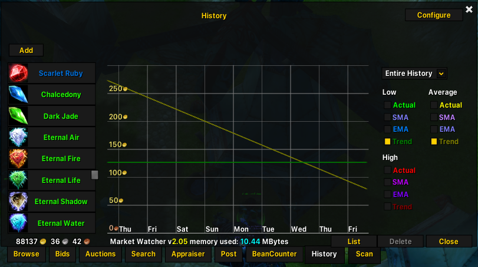
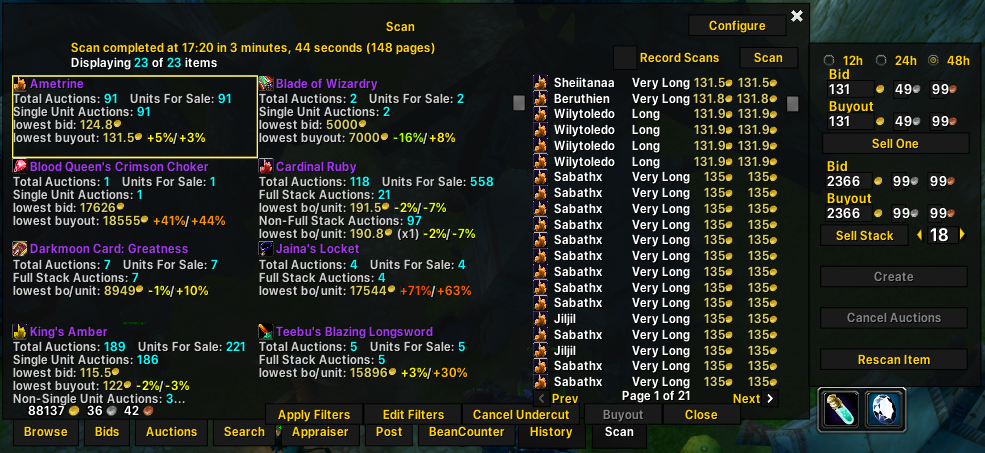
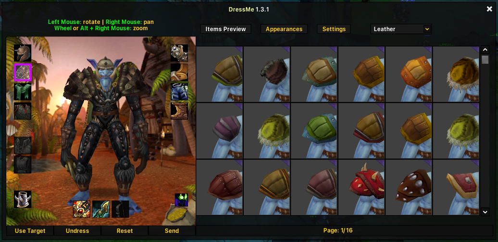
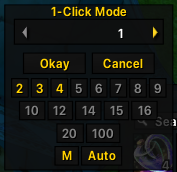
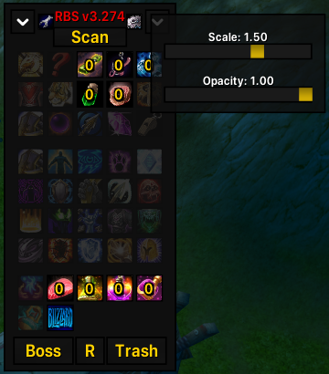
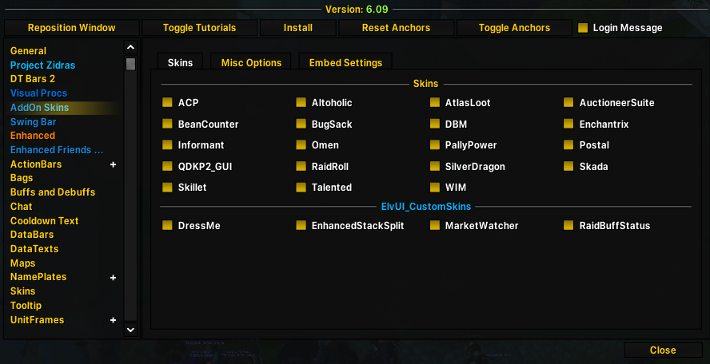

# ElvUI_CustomSkins

Extra addon skins for [ElvUI_AddOnSkins](https://github.com/ElvUI-WotLK/ElvUI_AddOnSkins) (WotLK 3.3.5), shipped as a separate addon so the original AddOnSkins code never has to be edited.

**Version:** 1

## Included skins

| Addon | What gets skinned | Preview |
| --- | --- | --- |
| [MarketWatcher](https://www.curseforge.com/wow/addons/market-watcher/files/422870) | Auction house History and Scan tabs, dialogs, filters, config window, tooltips | <a href="screenshots/marketwatcher1.png"></a><br><a href="screenshots/marketwatcher2.png"></a> |
| [DressMe](https://github.com/GetLocalPlayer/DressMe) | Main window, dressing room, slots, tabs, dropdowns, preview tiles, lists | <a href="screenshots/dressme.png"></a> |
| [EnhancedStackSplit](https://www.curseforge.com/wow/addons/enhanced-stack-split/files/422345) | Stack split frame, always using the expanded (XL) layout | <a href="screenshots/ess.png"></a> |
| [RaidBuffStatus](https://www.curseforge.com/wow/addons/raidbuffstatus/files/457723) | Dashboard, talents window, options window, plus Scale / Opacity sliders | <a href="screenshots/rbs.png"></a> |

<a href="screenshots/screenshot.png"></a>

Each skin only applies if the target addon is installed and loaded.

## Requirements

- WoW 3.3.5 (Interface 30300)
- [ElvUI (WotLK)](https://github.com/ElvUI-WotLK/ElvUI)
- [ElvUI_AddOnSkins (WotLK)](https://github.com/ElvUI-WotLK/ElvUI_AddOnSkins)

## Installation

1. Download or clone this repository.
2. Copy the inner **`ElvUI_CustomSkins`** folder (the one containing `ElvUI_CustomSkins.toc`) into `Interface\AddOns\`.
3. Fully quit and restart the game client.

The final layout must be:

```
Interface\AddOns\ElvUI_CustomSkins\ElvUI_CustomSkins.toc
Interface\AddOns\ElvUI_CustomSkins\core.lua
Interface\AddOns\ElvUI_CustomSkins\skins\*.lua
```

> **Note:** WoW caches each addon's file list. After adding or renaming files in the `.toc`, `/reload` is not enough; restart the client.

## Usage

Open ElvUI and go to **AddOn Skins > Skins**. A **ElvUI_CustomSkins** section lists one checkbox per custom skin. Changing a checkbox shows a reload prompt; the new setting applies after the UI reloads.

Settings are stored alongside AddOnSkins' own toggles in `E.private.addOnSkins`. A skin is enabled unless its value is explicitly `false`.

## Configuration

Each skin has options at the top of its file in `skins/`. They are plain Lua constants: edit the value, save, then `/reload`.

### Border colour (all skins)

| Option | Description |
| --- | --- |
| `BORDER_MODE` | `"elvui"` keeps ElvUI's border colour, `"class"` uses your class colour, `"custom"` uses the colour below |
| `BORDER_R, BORDER_G, BORDER_B` | Colour used in `"custom"` mode (ignored otherwise) |

| Skin | Default `BORDER_MODE` | Default custom colour |
| --- | --- | --- |
| MarketWatcher | `"elvui"` | 0.45, 0.45, 0.45 |
| DressMe | `"elvui"` | 0.7, 0.7, 0.7 |
| EnhancedStackSplit | `"class"` | 0.7, 0.7, 0.7 |
| RaidBuffStatus | `"elvui"` | 0.7, 0.7, 0.7 |

### MarketWatcher (`skins/MarketWatcher.lua`)

| Option | Default | Description |
| --- | --- | --- |
| `HIDE_PRICE_GRAPH` | `true` | Hide the price history graph above the scan tooltip. `false` skins it with a black background and border |
| `CHECKBOX_FILL` | `{1, 0.82, 0}` | Colour of the tick in checked boxes |
| `CHECKBOX_FILL_DISABLED` | `{0.5, 0.5, 0.5}` | Tick colour for disabled boxes |
| `SELL_LABEL_SIZE` | `18` | Font size of the "Bid" / "Buyout" labels in the sell panel (row gaps adjust to fit) |
| `SELL_BOX_SIZE` | `18` | Font size of the gold / silver / copper boxes |

`DROPDOWN_X, DROPDOWN_Y` (`-20, 39`) nudge the history period dropdown. They are defined inside `SkinHistoryGraphOptions` rather than at the top of the file.

### DressMe (`skins/DressMe.lua`)

| Option | Default | Description |
| --- | --- | --- |
| `SELECTED_R, SELECTED_G, SELECTED_B` | `0.843, 0, 1` | Border colour of the selected slot or preview tile |
| `SELECTED_THICKNESS` | `3` | Border thickness of the selected slot, in pixels |
| `HIGHLIGHT_ALPHA` | `0.12` | Strength of the white hover / selected overlay on slots (ElvUI's default is 0.3) |
| `DROPDOWN_WIDTH` | `130` | Width of the dropdown boxes |
| `DROPDOWN_HEIGHT` | `22` | Height of the dropdown boxes |
| `SUBCLASS_MENU_DOWN` | `9` | Moves the item type dropdown down so it lines up with the tabs |

### EnhancedStackSplit (`skins/EnhancedStackSplit.lua`)

| Option | Default | Description |
| --- | --- | --- |
| `BTN_H` | `20` | Height of the numbered and control buttons |
| `MAIN_H` | `22` | Height of Okay, Cancel and the "1" button |
| `GAP` | `2` | Gap between neighbouring buttons |
| `MAIN_Y` | `36` | Vertical position of the Okay / Cancel row |
| `ROW1_TOP` | `21` | Top edge of the first button row (2-9) |
| `ROW_PITCH` | `23` | Distance between button rows |
| `BG_PADDING` | `5` | Space between the last row and the bottom of the backdrop |
| `MAX_BUTTONS` | `24` | How many of the addon's numbered buttons are checked |
| `HIDDEN_AMOUNTS` | `{}` | Amounts to remove, e.g. `{ ["100"] = true }` drops the 100 button |

### RaidBuffStatus (`skins/RaidBuffStatus.lua`)

| Option | Default | Description |
| --- | --- | --- |
| `DASHBOARD_SCALE` | `1.3` | Dashboard window scale |
| `TALENTS_SCALE` | `1.0` | Talents window scale |
| `OPTIONS_SCALE` | `1.0` | Options window scale |
| `DASHBOARD_ALPHA` | `1.0` | Dashboard background opacity |
| `TALENTS_ALPHA` | `1.0` | Talents window background opacity |
| `OPTIONS_ALPHA` | `nil` | Options window opacity (`nil` uses ElvUI's default transparency) |
| `TALENT_ICON_SIZE` | `20` | Icon size in the talents window |
| `TALENT_ROW_GAP` | `6` | Space between rows, in pixels |
| `TALENT_DIVIDERS` | `true` | Draw a thin line between entries |
| `TALENT_ICON_GAP` | `1` | Gap between the specialisation icons |
| `TITLE_FONT_SIZE` | `10` | Font size of the "RBS v3.xxx" title on the dashboard |

`DASHBOARD_SCALE` and `DASHBOARD_ALPHA` are only starting values. The in-game Scale / Opacity sliders save their own values (`skinScale`, `skinAlpha`) in the RaidBuffStatus profile, and those take priority once the sliders have been used.

## Adding a skin

1. Add the addon name to `CUSTOM_SKIN_NAMES` in `core.lua` so it gets a checkbox.
2. Create `skins/<Name>.lua`.
3. Add that path to the `.toc`.
4. In the skin, skip work when the toggle is off:

   ```lua
   if E.private and E.private.addOnSkins and E.private.addOnSkins.<Name> == false then return end
   ```

Skins should run after ElvUI has initialised (`PLAYER_LOGIN` or later), because ElvUI's API and database are not ready before then.

## Troubleshooting

- **Addon loads but no skin applies:** restart the client fully (see the note above), then check that the files exist in `skins\`.
- **Check that it loaded:** `/run print(IsAddOnLoaded("ElvUI_CustomSkins"), ElvUI[1].CustomSkins ~= nil)` should print `1 true`.
- **Check individual skins:** `/run print(DressMe_SkinLoaded, EnhancedStackSplit_SkinLoaded, RaidBuffStatus_SkinLoaded)` should print `true true true` when the skin files are loaded.
- **Lua errors:** enable them with `/console scriptErrors 1` and include the error text when reporting an issue.

## Notes

- The checkboxes are always listed, whether or not the target addon is installed.
- EnhancedStackSplit's skin removes the XL toggle button and keeps the expanded layout on.
